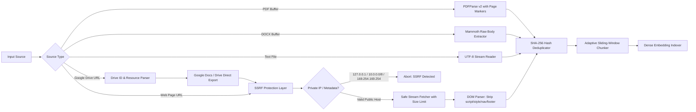
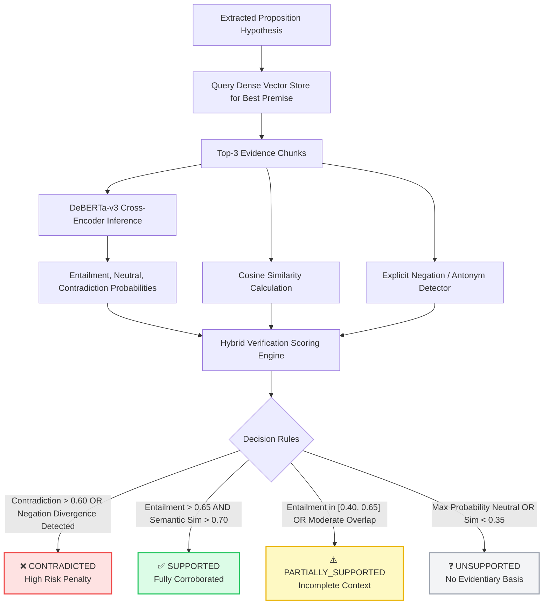

# VeriRAG: Claim-Level Hallucination Detection & Verification Engine for RAG Systems

<p align="center">
  
</p>

<p align="center">
  <a href="https://github.com/Khush-33/VeriRAG_edi/actions"></a>
  <a href="https://colab.research.google.com/github/Khush-33/VeriRAG_edi/blob/main/training/VeriRAG_Training.ipynb"></a>
  <a href="https://colab.research.google.com/github/Khush-33/VeriRAG_edi/blob/main/training/VeriRAG_Evaluation.ipynb"></a>
  <a href="LICENSE"></a>
  <a href="https://huggingface.co/Xenova/nli-deberta-v3-small"></a>
</p>

---

## 📌 Executive Summary

**VeriRAG** is a research-grade framework engineered to audit, detect, classify, and mitigate hallucinations produced by Retrieval-Augmented Generation (RAG) pipelines. While standard RAG systems retrieve documents and prompt an LLM, they often produce **subtle, high-confidence hallucinations**—statements that sound authoritative but contradict or lack support in the source corpus.

VeriRAG solves this by implementing **fine-grained atomic claim decomposition**, **dense vector evidence retrieval**, and a **hybrid cross-encoder Natural Language Inference (NLI) scoring engine**. Responses are broken down into discrete propositions and scored against retrieved evidence passages, producing an interpretable, citation-backed reliability report.

---

## 🏗 End-to-End System Architecture

```mermaid
flowchart TD
    subgraph Ingestion["1. Multi-Source Ingestion & Security"]
        A[Raw Input: PDF / DOCX / TXT / Web URL / Google Drive] --> B{SSRF Security Filter}
        B -- Blocked Private IP / Metadata --> C[Reject Request with 403 Forbidden]
        B -- Public Domain / Valid File --> D[Text & Metadata Extraction]
        D --> E[SHA-256 Content Deduplication]
    end

    subgraph Indexing["2. Semantic Indexing & Vector Store"]
        E --> F[Sliding-Window Semantic Chunking]
        F --> G[MiniLM-L6-v2 Dense Embedding 384-d]
        G --> H[(In-Memory Dense Vector Store)]
    end

    subgraph Generation["3. Query & RAG Generation"]
        Q[User Query] --> H
        H --> K[Top-k Retrieved Context Chunks]
        Q --> L[Gemini / Local LLM Generator]
        K --> L
        L --> M[Synthesized RAG Response]
    end

    subgraph Verification["4. Atomic Claim Verification Engine"]
        M --> N[Atomic Claim Splitter & Normalizer]
        N --> O[Individual Propositions {c₁, c₂, ..., cₙ}]
        O --> P[Dense Evidence Passage Matcher]
        P --> R[DeBERTa-v3 NLI Cross-Encoder]
        P --> S[Lexical Overlap & Negation Detector]
        R --> T[Hybrid Confidence & Risk Scoring]
        S --> T
    end

    subgraph Output["5. Explainable Verdicts & UI"]
        T --> U{4-Class Verdict Taxonomy}
        U --> V1[SUPPORTED: Green]
        U --> V2[PARTIALLY_SUPPORTED: Yellow]
        U --> V3[CONTRADICTED: Red]
        U --> V4[UNSUPPORTED: Gray]
        V1 & V2 & V3 & V4 --> W[Interactive Dashboard & Citation Inspector]
    end

    style Ingestion fill:#f8fafc,stroke:#64748b,stroke-width:2px
    style Indexing fill:#f0fdf4,stroke:#22c55e,stroke-width:2px
    style Generation fill:#eff6ff,stroke:#3b82f6,stroke-width:2px
    style Verification fill:#faf5ff,stroke:#a855f7,stroke-width:2px
    style Output fill:#fff7ed,stroke:#f97316,stroke-width:2px
```

---

## 🔍 Ingestion Pipeline & SSRF Protection Flowchart

VeriRAG includes enterprise-grade ingestion safeguards that sanitize external inputs before indexing:



---

## ⚖️ Claim Verification Decision Flowchart

Each generated sentence is broken into atomic clauses and verified through multi-signal agreement:



---

## 🏷️ 4-Class Verdict Taxonomy

| Verdict | Color Code | Description | Actionable Guidance |
| :--- | :---: | :--- | :--- |
| **`SUPPORTED`** | 🟢 Green | Premise directly entails the claim with strong lexical and semantic corroboration ($P_{\text{entail}} \ge 0.65$). | Safe to present to users; citations explicitly confirmed. |
| **`PARTIALLY_SUPPORTED`** | 🟡 Yellow | The general premise is confirmed, but specific qualifiers, dates, or numbers lack precise corroboration. | Flagged for user inspection; prompts clarification request. |
| **`CONTRADICTED`** | 🔴 Red | The claim directly disputes or reverses facts stated in the retrieved reference context ($P_{\text{contra}} \ge 0.60$ or negation mismatch). | High-risk hallucination; filtered or flagged with warning banner. |
| **`UNSUPPORTED`** | ⚪ Gray | No evidence chunk in the corpus corroborates or discusses the proposition ($P_{\text{neutral}} \approx 1.0$). | Extrinsic hallucination (LLM world knowledge injection). |

---

## 🧪 Benchmark & Training Pipelines (Google Colab Ready)

VeriRAG models are fine-tuned and benchmarked using the official **RAGTruth** academic dataset across QA, summarization, and data-to-text generation tasks. All notebooks include automated Google Colab detection, GPU acceleration, and crash-proof OOM handling:

| Notebook | Description | Open in Colab |
| :--- | :--- | :---: |
| **`VeriRAG_Training.ipynb`** | Fine-tunes `microsoft/deberta-v3-small` cross-encoder with weighted cross-entropy and FP16 mixed precision. | [](https://colab.research.google.com/github/Khush-33/VeriRAG_edi/blob/main/training/VeriRAG_Training.ipynb) |
| **`VeriRAG_Evaluation.ipynb`** | Evaluates checkpoints on held-out test splits, generating ROC curves, PR curves, Confusion Matrices, and error tables. | [](https://colab.research.google.com/github/Khush-33/VeriRAG_edi/blob/main/training/VeriRAG_Evaluation.ipynb) |
| **`VeriRAG_Data_Exploration.ipynb`** | Exploratory Data Analysis (EDA) of RAGTruth distributions, token lengths, and class balance. | [](https://colab.research.google.com/github/Khush-33/VeriRAG_edi/blob/main/training/VeriRAG_Data_Exploration.ipynb) |

---

## 💻 Tech Stack & Specifications

- **Frontend:** React 19, TypeScript, Tailwind CSS, Lucide Icons, Motion (Framer Motion).
- **Backend & Server:** Node.js (v20+), Express, TSX, esbuild.
- **ML / NLI Inference:** `@xenova/transformers` (ONNX runtime for in-browser / Node.js execution), PyTorch 2.0+ (Python fine-tuning).
- **Embeddings:** `all-MiniLM-L6-v2` (384-dimensional dense vectors with Cosine indexing).
- **LLM Synthesis:** Google Gemini 2.5 / 2.0 Flash via `@google/genai` (with fallback rule-based synthesis).
- **Testing:** Node.js Native Test Runner (`node:test`, `node:assert/strict`).

---

## ⚡ Quickstart Guide

### Prerequisites
- Node.js (v18 or higher, v20+ recommended)
- Python 3.10+ (optional, only needed for model training)
- Gemini API Key (optional, defaults to local mock synthesis if absent)

### 1. Clone & Install

```bash
# Clone the repository
git clone https://github.com/Khush-33/VeriRAG_edi.git
cd verirag

# Install frontend and server dependencies
npm install
```

### 2. Configure Environment

Create a `.env` file in the root directory:

```env
PORT=3000
GEMINI_API_KEY=your_gemini_api_key_here
```

### 3. Run Development Server

```bash
# Starts both frontend client and backend API
npm run dev
```

Open your browser at `http://localhost:3000`.

### 4. Run the Test Suite

```bash
# Run all unit, SSRF, PDF, DOCX, and chunking regression tests
npm test
```

---

## 📂 Project Directory Structure

```text
verirag/
├── datasets/                     # RAGTruth benchmark dataset & ground-truth annotations
│   └── ragtruth/
│       └── ragtruth_dataset.json # Curated RAGTruth QA & verification benchmark
├── docs/                         # Architecture, API, and multi-source ingestion docs
├── public/                       # Static assets & banner
├── src/
│   ├── components/               # React UI views (ChatView, KnowledgeBase, HomeView)
│   │   └── ui/                   # Reusable UI cards, badges, statistics counters
│   ├── server/                   # Backend engines & ingestion adapters
│   │   ├── docxExtractor.ts      # DOCX raw text extraction
│   │   ├── driveFetcher.ts       # Google Drive / Docs ingestion adapter
│   │   ├── ingestionPipeline.ts  # Multi-source coordinator with deduplication
│   │   ├── pdfExtractor.ts       # PDF extraction with page segmentation
│   │   ├── urlFetcher.ts         # SSRF-protected HTTP scraper
│   │   ├── vectorStore.ts        # In-memory dense 384-d cosine vector store
│   │   └── verificationEngine.ts # Atomic claim splitter & DeBERTa NLI cross-encoder
│   └── types.ts                  # Shared TypeScript interface definitions
├── tests/                        # Regression & integration tests
│   ├── chunking-regression.test.ts
│   ├── ingestion.test.ts         # SSRF protection, URL, DOCX, Drive tests
│   └── pdf-extractor.test.ts     # Corrupt PDF rejection & pagination tests
├── training/                     # Python research & fine-tuning workflows
│   ├── config.py                 # Hyperparameters & dynamic path resolver
│   ├── dataset.py                # RAGTruth dataset partitioner with fallback
│   ├── requirements.txt          # Python dependencies
│   ├── VeriRAG_Training.ipynb    # Google Colab training notebook
│   ├── VeriRAG_Evaluation.ipynb  # Google Colab evaluation & metrics notebook
│   └── VeriRAG_Data_Exploration.ipynb # EDA notebook
├── package.json
├── server.ts                     # Main Express server entrypoint
├── tsconfig.json                 # TypeScript compiler configuration
└── vite.config.ts                # Vite frontend bundler configuration
```

---

## 📜 License & Acknowledgements

- **License:** Distributed under the [MIT License](LICENSE).
- **Benchmark Acknowledgement:** Evaluated against the **RAGTruth** benchmark corpus ([RAGTruth: A Hallucination Benchmark for Retrieval-Augmented Generation](https://arxiv.org/abs/2312.00849)).
- **Model Checkpoints:** Built on top of Microsoft's **DeBERTa-v3** architecture.
